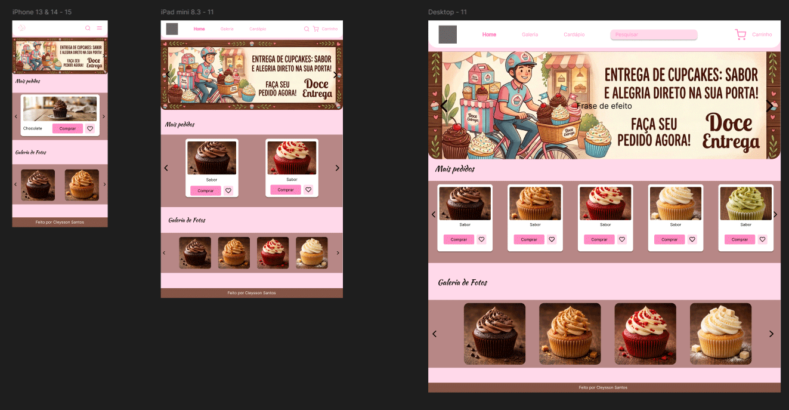
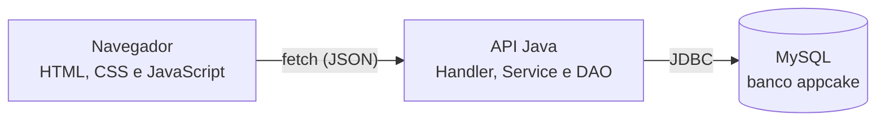
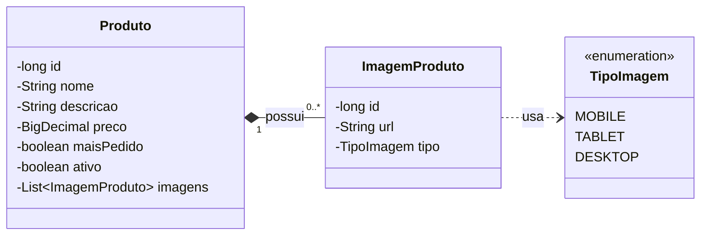
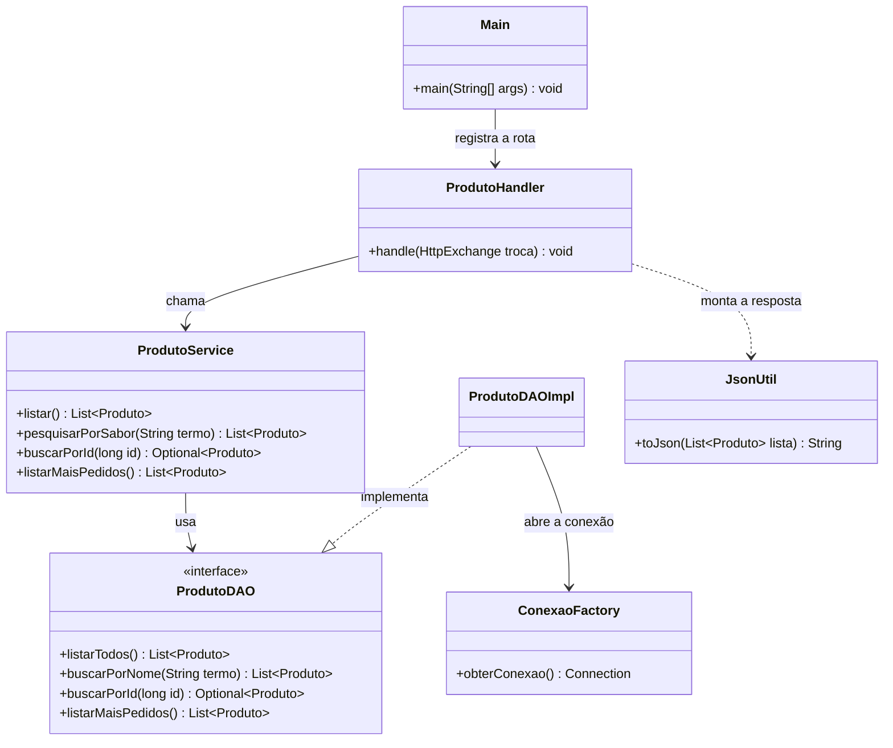
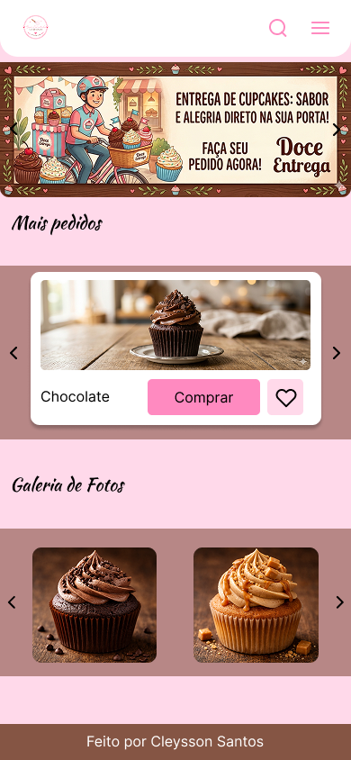
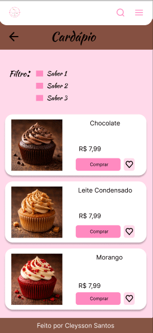
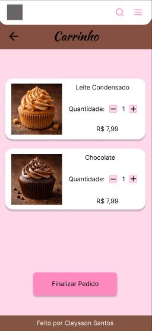
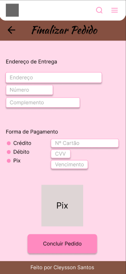

# 🧁 APPCAKE

Uma loja virtual responsiva para venda de cupcakes, desenvolvida com foco em uma experiência moderna e intuitiva.

A ideia surgiu de um trabalho da faculdade onde era pra fazer apenas o Wireframe das telas. Então decidi colocar meus conhecimentos em prática para aperfeiçoar minhas habilidades de Front-end. Na evolução do projeto, adicionei um **back-end em Java puro com banco de dados MySQL**, responsável pelo catálogo de cupcakes e pela pesquisa de sabores.

## 📷 Preview



## 🚀 Funcionalidades

**Front-end**

- ✅ Página inicial responsiva com carrossel de banners e "Mais pedidos"
- ✅ Cardápio com os sabores de cupcake
- ✅ Galeria de fotos com imagem ampliada (modal)
- ✅ Carrinho de compras com controle de quantidade (salvo no navegador)
- ✅ Pagamento com cartão, boleto ou Pix e validação dos campos
- ✅ Tela de pedido concluído
- ✅ Layout Mobile First
- ✅ Navegação intuitiva

**Back-end**

- ✅ Catálogo de cupcakes armazenado no MySQL
- ✅ Pesquisa de sabores pelo campo de busca do cabeçalho
- ✅ API REST que devolve os dados em JSON

## 🛠️ Tecnologias

**Front-end**

- HTML5
- CSS3
- JavaScript

**Back-end**

- Java (puro, sem frameworks como Spring)
- JDBC com o driver MySQL Connector/J
- MySQL 8
- Servidor HTTP do próprio JDK (`com.sun.net.httpserver`)

## 📱 Responsividade

O projeto foi desenvolvido utilizando a abordagem **Mobile First**, garantindo uma boa experiência em:

- 📱 Smartphones
- 💻 Tablets
- 🖥️ Desktops

## 🏗️ Arquitetura

O front-end (HTML, CSS e JavaScript) consome a API do back-end, que consulta o MySQL:



O back-end é dividido em camadas, e cada uma tem uma única responsabilidade:

| Pacote | Classe(s) | Responsabilidade |
|---|---|---|
| `model` | `Produto`, `ImagemProduto`, `TipoImagem` | Representam os dados (POJOs) |
| `dao` | `ProdutoDAO`, `ProdutoDAOImpl` | Acesso ao MySQL via JDBC; todo o SQL fica aqui |
| `service` | `ProdutoService` | Regras de negócio (ex.: termo de busca vazio lista todos os sabores) |
| `web` | `ProdutoHandler` | Recebe as requisições HTTP, chama o Service e responde em JSON |
| `util` | `ConexaoFactory`, `JsonUtil` | Conexão com o banco e conversão de objetos para JSON |
| (raiz) | `Main` | Monta as camadas e liga o servidor |

### Diagrama de classes: modelo de domínio



### Diagrama de classes: camadas do back-end



### Como a pesquisa funciona

1. O usuário digita um sabor no campo do cabeçalho e aperta Enter.
2. O `search.js` chama o `api.js`, que faz `GET /api/produtos/pesquisa?termo=...`.
3. O `ProdutoHandler` recebe a requisição e chama o `ProdutoService`.
4. O `ProdutoService` aplica as regras e chama o `ProdutoDAO`.
5. O `ProdutoDAOImpl` executa o SQL com `PreparedStatement` (protege contra SQL Injection) e um `LEFT JOIN` que traz o produto junto com suas imagens.
6. O resultado volta em JSON e o `search.js` mostra os cards num painel.

## 🗄️ Banco de dados

O script [`backend/sql/schema.sql`](./backend/sql/schema.sql) cria o banco `appcake`, as tabelas e os dados iniciais (9 sabores).

| Tabela | Colunas principais |
|---|---|
| `produto` | `id` (PK), `nome` (único), `descricao`, `preco`, `mais_pedido`, `ativo` |
| `imagem_produto` | `id` (PK), `produto_id` (FK para `produto`), `url`, `tipo` (MOBILE, TABLET ou DESKTOP) |

Um produto possui várias imagens (uma por tamanho). O campo `ativo` permite tirar um sabor do ar sem apagá-lo, e o `UNIQUE` em `nome` também cria o índice usado na pesquisa.

## 🔌 API

Todas as rotas usam o método `GET` e respondem em JSON.

| Rota | O que faz |
|---|---|
| `/api/produtos` | Lista todos os produtos ativos |
| `/api/produtos/pesquisa?termo=choc` | Pesquisa por sabor (contém o termo; ignora maiúsculas e acentos) |
| `/api/produtos/mais-pedidos` | Lista os "mais pedidos" |
| `/api/produtos/{id}` | Devolve um produto pelo id (404 se não existir) |

Exemplo de resposta:

```json
[{"id":1,"nome":"Chocolate","descricao":"Massa de chocolate macia e úmida...","preco":7.99,"maisPedido":true,
  "imagens":[{"tipo":"MOBILE","url":"assets/images/mobile/cupcake-chocolate-sm.png"},
             {"tipo":"TABLET","url":"assets/images/tablet/cupcake-chocolate-md.png"}]}]
```

## ▶️ Como executar

### Requisitos

- **JDK 25.** O `main` do projeto é declarado como `static void main`, sem `public`, o que só é aceito a partir do Java 25. Em versões anteriores (17 a 24), troque para `public static void main` no `Main.java`.
- MySQL 8 ou superior
- Driver JDBC do MySQL, que já está em `backend/lib/`

### 1. Criar o banco

Abra o `backend/sql/schema.sql` no MySQL Workbench e execute o script inteiro, ou use o terminal:

```bash
mysql -u root -p < backend/sql/schema.sql
```

### 2. Ligar o back-end

No IntelliJ, abra a pasta `backend`, marque `src` como **Sources Root**, adicione o `.jar` de `backend/lib` em **File → Project Structure → Libraries** e rode o `Main`.

A senha do MySQL é informada por variável de ambiente, em **Run → Edit Configurations → Environment variables**:

| Variável | Padrão | Para que serve |
|---|---|---|
| `DB_PASSWORD` | (vazia) | Senha do MySQL |
| `DB_USER` | `root` | Usuário do MySQL |
| `DB_URL` | `jdbc:mysql://localhost:3306/appcake?...` | Endereço do banco |
| `PORT` | `8080` | Porta da API |

Se tudo estiver certo, o console mostra:

```text
[OK] Conectado ao MySQL.
[OK] Servidor no ar: http://localhost:8080/api/produtos
```

Para testar só a API, abra no navegador `http://localhost:8080/api/produtos/pesquisa?termo=choc`.

Pelo terminal, dentro da pasta `backend`, também é possível compilar e executar:

```bash
javac -encoding UTF-8 -d out -sourcepath src src/Main.java
java -cp "out;lib/*" Main      # Windows
java -cp "out:lib/*" Main      # Linux e macOS
```

### 3. Abrir o front-end

Abra o site por um servidor local, e não dando dois cliques no HTML, porque os caminhos dos arquivos dependem disso:

- **IntelliJ:** abra o `frontend/index.html` e clique no ícone de navegador no canto do editor
- **VS Code:** use a extensão Live Server
- **Python:** rode `python -m http.server 5500` dentro da pasta `frontend`

Com o back-end ligado, digite um sabor (por exemplo, `choc`) no campo de busca do cabeçalho e aperte Enter.

## 📂 Estrutura do projeto

```text
📦 APPCAKE
 ┣ 📂 backend
 ┃ ┣ 📂 lib                 (driver JDBC do MySQL)
 ┃ ┣ 📂 sql
 ┃ ┃ ┗ 📜 schema.sql
 ┃ ┗ 📂 src
 ┃   ┣ 📂 dao               (ProdutoDAO, ProdutoDAOImpl)
 ┃   ┣ 📂 model             (Produto, ImagemProduto, TipoImagem)
 ┃   ┣ 📂 service           (ProdutoService)
 ┃   ┣ 📂 util              (ConexaoFactory, JsonUtil)
 ┃   ┣ 📂 web               (ProdutoHandler)
 ┃   ┗ 📜 Main.java
 ┣ 📂 frontend
 ┃ ┣ 📂 src
 ┃ ┃ ┣ 📂 assets
 ┃ ┃ ┃ ┗ 📂 images
 ┃ ┃ ┃   ┣ 📂 desktop
 ┃ ┃ ┃   ┣ 📂 mobile
 ┃ ┃ ┃   ┗ 📂 tablet
 ┃ ┃ ┣ 📂 data
 ┃ ┃ ┃ ┗ 📜 produtos.json   (catálogo local usado no modo demonstração)
 ┃ ┃ ┣ 📂 pages
 ┃ ┃ ┃ ┣ 📜 cardapio.html
 ┃ ┃ ┃ ┣ 📜 carrinho.html
 ┃ ┃ ┃ ┣ 📜 galeria.html
 ┃ ┃ ┃ ┣ 📜 pagamento.html
 ┃ ┃ ┃ ┗ 📜 pedido-concluido.html
 ┃ ┃ ┣ 📂 scripts
 ┃ ┃ ┃ ┣ 📂 commons
 ┃ ┃ ┃ ┃ ┣ 📜 api.js        (comunicação com o back-end)
 ┃ ┃ ┃ ┃ ┣ 📜 buttons.js    (carrinho e favoritos)
 ┃ ┃ ┃ ┃ ┣ 📜 carrossel.js
 ┃ ┃ ┃ ┃ ┣ 📜 header.js
 ┃ ┃ ┃ ┃ ┗ 📜 search.js     (pesquisa de sabores)
 ┃ ┃ ┃ ┗ 📂 pages
 ┃ ┃ ┃   ┣ 📜 carrinho.js
 ┃ ┃ ┃   ┣ 📜 galeria.js
 ┃ ┃ ┃   ┗ 📜 pagamento.js
 ┃ ┃ ┗ 📂 styles
 ┃ ┃   ┣ 📂 components      (variaveis, search, gallery-modal)
 ┃ ┃   ┣ 📂 layouts         (header, footer, top-bar)
 ┃ ┃   ┣ 📂 pages           (home, cardapio, carrinho, galeria, pagamento, pedido-concluido)
 ┃ ┃   ┣ 📂 vendor
 ┃ ┃   ┃ ┗ 📂 fonts
 ┃ ┃   ┗ 📜 global.css
 ┃ ┗ 📜 index.html
 ┣ 📜 index.html
 ┗ 📜 README.md
```

## 🎯 Objetivo

Este projeto foi desenvolvido para praticar conceitos de desenvolvimento Front-end, incluindo HTML semântico, CSS responsivo e JavaScript para interação do usuário. Com o back-end, o objetivo foi também praticar Java orientado a objetos (encapsulamento, interfaces e polimorfismo), o padrão DAO, a arquitetura em camadas, o acesso a banco de dados com JDBC e a comunicação entre front-end e back-end por meio de uma API REST.

## 📸 Screenshots

### Home



### Galeria


### Cardápio



### Carrinho



### Finalizar Pedido



## 🔗 Demonstração

GitHub Pages:

https://cleysson-santos.github.io/Projeto-Integrador-Cupcakes/

O GitHub Pages hospeda apenas arquivos estáticos e não executa Java nem MySQL. Por isso, no site publicado a pesquisa funciona em **modo demonstração**: como a API não responde, o site usa uma cópia local do catálogo (`frontend/src/data/produtos.json`) e mostra um aviso no painel de resultados. Para ver a pesquisa usando o MySQL de verdade, execute o projeto localmente, conforme a seção **Como executar**.

## 👨‍💻 Autor

**Cleysson Santos**

LinkedIn:
https://linkedin.com/in/cleysson-santos

GitHub:
https://github.com/cleysson-santos
